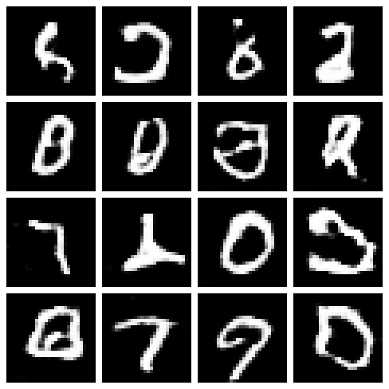

# sps_genai

FastAPI service for the Columbia SPS GenAI course (Yihan Wang, yw4669).

## Endpoints

| Method | Path | What it does |
|---|---|---|
| GET | `/` | Health check |
| POST | `/generate` | Bigram text generation. Body: `{"start_word": "the", "length": 10}` |
| POST | `/embedding` | spaCy word vector (300-dim). Body: `{"word": "king"}` |
| GET | `/similarity?word1=king&word2=queen` | Cosine similarity of two words |
| POST | `/classify` | **Assignment 2.** Upload an image, returns the predicted CIFAR-10 class |
| GET | `/generate_digits?num_images=16&seed=42` | **Assignment 3.** GAN generates hand-written digits, returns a PNG grid |

## Assignment 3: GAN for hand-written digits (MNIST)

- `app/gan_model.py`: the required GAN architecture
  - **Generator:** noise (B, 100) → Linear → 7x7x128 → reshape → ConvTranspose2d(128→64, k4, s2, p1) → BatchNorm → ReLU (14x14) → ConvTranspose2d(64→1, k4, s2, p1) → Tanh (28x28)
  - **Discriminator:** image (1, 28, 28) → Conv2d(1→64, k4, s2, p1) → LeakyReLU(0.2) (14x14) → Conv2d(64→128, k4, s2, p1) → BatchNorm → LeakyReLU(0.2) (7x7) → Flatten → Linear → Sigmoid (real/fake probability)
- `train_gan.py`: trains on MNIST (BCE loss, Adam lr 0.0002, betas (0.5, 0.999)) and saves the generator to `app/models/gan_generator.pth`
- `app/gan_generator.py`: loads the generator and turns random noise into a PNG grid of digits

The trained generator is included. To retrain: `uv run python train_gan.py --epochs 20`

Example output (`sample_images/gan_digits.png`):



Try it: open http://127.0.0.1:8000/docs → `GET /generate_digits` → Try it out → Execute, or open http://127.0.0.1:8000/generate_digits?num_images=16 directly in the browser.

## Assignment 2: CNN image classifier

- `app/cnn_model.py`: the required CNN architecture (`AssignmentCNN`)
  - Input 64x64x3 → Conv(16, 3x3, s1, p1) → ReLU → MaxPool(2, 2) → Conv(32, 3x3, s1, p1) → ReLU → MaxPool(2, 2) → Flatten (8192) → FC(100) → ReLU → FC(10)
  - CIFAR-10 images (32x32) are resized to 64x64 to match the required input size
- `train_cnn.py`: trains the model on CIFAR-10 and saves `app/models/cnn_cifar10.pth`
- `app/cnn_classifier.py`: loads the trained weights and runs inference
- Classes: airplane, automobile, bird, cat, deer, dog, frog, horse, ship, truck

The trained weights are already included, so the API works without retraining. To retrain:

```bash
uv run python train_cnn.py --epochs 10
```

## Run locally

```bash
uv sync
uv run fastapi dev app/main.py
```

Open http://127.0.0.1:8000/docs, or:

```bash
curl -X POST http://127.0.0.1:8000/classify -F "file=@cat.jpg"
```

Example response:

```json
{
  "filename": "cat.jpg",
  "predicted_class": "cat",
  "confidence": 0.71,
  "top_k": [
    {"class": "cat", "probability": 0.71},
    {"class": "dog", "probability": 0.18},
    {"class": "frog", "probability": 0.04}
  ]
}
```

## Run with Docker

```bash
docker build -t sps-genai .
docker run -p 8000:80 sps-genai
```

Then open http://127.0.0.1:8000/docs.
